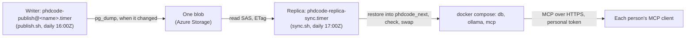

# A read-only replica of a phdcode library

One machine (the writer) runs the library: the sweep, the parse, the summaries, the uploads. A replica on another
host serves the same papers to the agents of a team over MCP, with the read tools only. The writer uploads a dump
when the library changes; the replica pulls it each day and swaps it in (ADR-0038).



## What the replica serves

- The tools `search_sources`, `get_paper`, `search_papers`, `search_chunks`, `get_chunks` (`PHDCODE_TOOLS`). The tools
  that write (`save_paper`, `ingest_pdf`, the saved searches) are not registered: a write would be lost at the next swap.
- No web page and no figures (the dump holds the database only).
- The token: each request carries a personal token, which `PHDCODE_MCP_AUTH_URL` must answer with 200.
- The data can be one day old.

## The writer

1. The env file `~/.config/phdcode/publish-<name>.env`: `PHDCODE_DIR` (the clone), `PG_CONTAINER`, `PG_USER`, `PG_DB`,
   `AZ_ACCOUNT`, `AZ_CONTAINER`, `AZ_BLOB`. The machine needs `az login` with write access to the blob.
2. `systemctl --user link <repo>/llm_engine/systemd/phdcode-publish@.{service,timer}`, then
   `systemctl --user enable --now phdcode-publish@<name>.timer`.

## The replica

1. `git clone https://github.com/fuminaba/phdcode /opt/phdcode` (the commit of the writer).
2. As root: `/etc/phdcode-replica/replica.env` from `replica.env.example`, mode 0600.
3. `cd /opt/phdcode/deploy/replica && sudo docker compose --env-file /etc/phdcode-replica/replica.env up -d --build`
4. `sudo cp phdcode-replica-sync.service phdcode-replica-sync.timer /etc/systemd/system/ && sudo systemctl daemon-reload &&
   sudo systemctl enable --now phdcode-replica-sync.timer && sudo systemctl start phdcode-replica-sync.service` (the first pull).
5. A TLS proxy in front of `127.0.0.1:8772/mcp`: it passes the `Authorization` and `Host` headers, and `MCP_HOSTS`
   names its public host. An exact location for the MCP path: a client calls it with no slash at the end.
6. A person adds the server to an MCP client, for example Claude Code:
   `claude mcp add --transport http phdcode https://<public host>/<path> --header "Authorization: Bearer <token>"`

## Check

```bash
sudo docker compose --env-file /etc/phdcode-replica/replica.env ps     # db healthy, ollama and mcp up
journalctl -u phdcode-replica-sync.service -n 5                         # "swapped: N papers" or "no new dump"
curl -s -o /dev/null -w "%{http_code}\n" -X POST http://127.0.0.1:8772/mcp   # 401: no token
```

An update: `git pull`, then step 3 again. A refused dump ("refused: the new dump has N papers") leaves the live copy.
