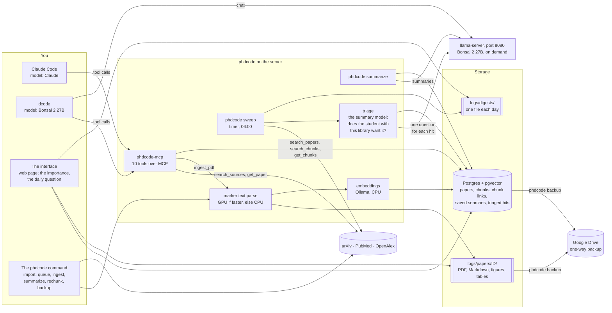
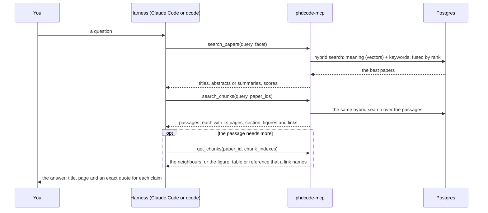
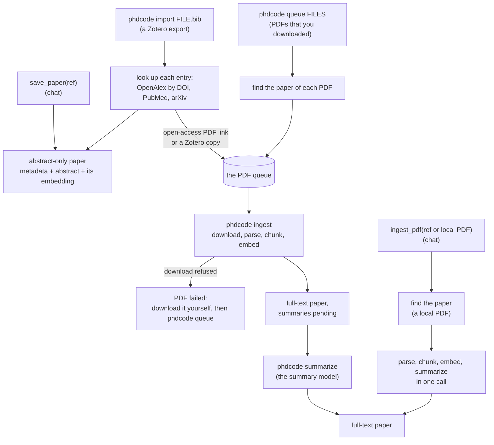
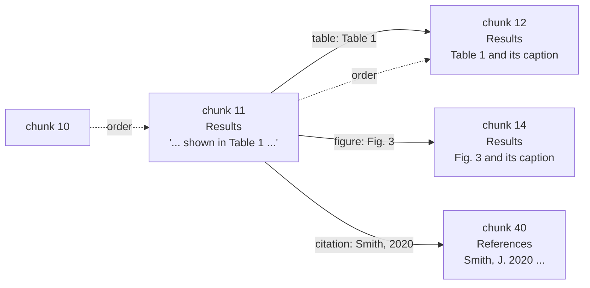
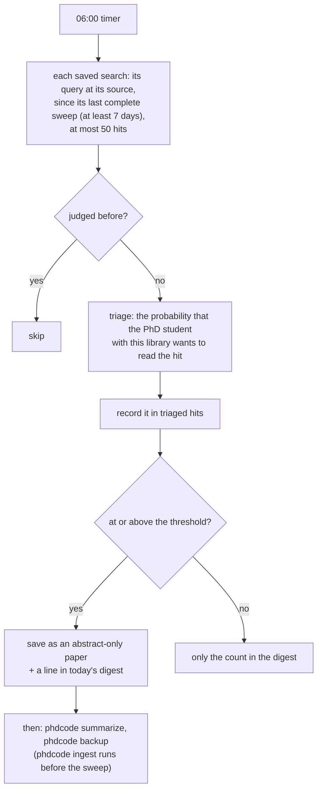
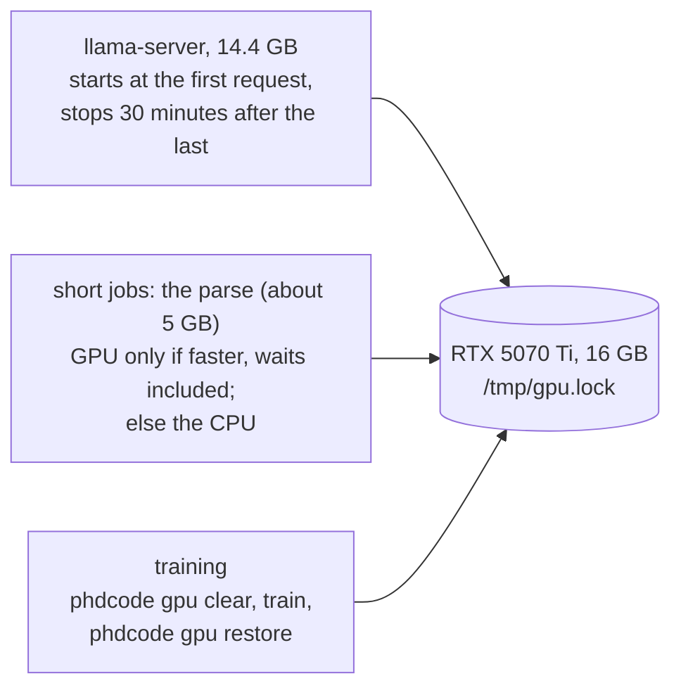

# How phdcode works

phdcode keeps your literature and gives tools to a chat. The chat (the harness and its model) is outside phdcode: Claude Code, dcode, or another MCP client. MCP connects the two. Some parts run with no chat: the import of a reference list, the PDF queue, the summaries, the daily sweep, the backup and the GPU rules.

## 1. The parts

A paper is **abstract-only** (its metadata and its abstract) or **full-text** (its parsed PDF in chunks, with pages, and a methods summary and a results summary).

## 2. A RAG question

The facet selects what `search_papers` searches: **concept** (the title and the abstract, all papers), **methods** or **results** (the summaries, full-text papers only).

## 3. Adding papers

**How phdcode finds the paper of a local PDF**, in this order. Steps 0 to 2 need no network.

| Step | Check | Result |
| --- | --- | --- |
| 0 | A paper already has this file in its PDF queue | that paper (a second `phdcode queue` of the file makes no duplicate) |
| 1 | A DOI on the first two pages is stored. An arXiv ID counts as the DOI `10.48550/arxiv.<id>` | the stored paper |
| 2 | The title of a stored paper is on the first page. The longest title wins | the stored paper |
| 3 | The DOI that OpenAlex gives for that DOI is stored. OpenAlex leads a preprint DOI to the journal version | the stored paper |
| 4 | OpenAlex knows the DOI | a new paper, with its metadata from OpenAlex |
| 5 | Nothing matches | a new empty paper: the summary model reads its title, authors and abstract from the text |

A paper that already has full text is not parsed again.

## 4. A paper as a graph of chunks

The parse gives one Markdown file for each paper. The chunker cuts it into chunks of about 1,500 characters. A table, and a figure with its caption, stay in one chunk. Each chunk keeps its pages and its **section path**: the headings above it, for example `3 Methods > 3.2 Data`.

A **chunk link** joins two chunks of one paper:

| Kind | From | To |
| --- | --- | --- |
| `figure` | a mention, for example "Fig. 3" or "Extended Data Fig. 1" | the chunk with the caption of that figure |
| `table` | a mention, for example "Table 2" | the chunk with the caption of that table |
| `ref` | an internal link of the PDF | the chunk with its target |
| `citation` | an internal link of the PDF | the chunk with its target, in the reference list |

The order of the chunks needs no link: the neighbours of chunk *i* are *i* − 1 and *i* + 1. `search_chunks` returns the links of each passage, and `get_chunks` reads their targets. `phdcode rechunk` makes the chunks and the links again from the parsed text, with no new parse.

## 5. The daily sweep

A **saved search** is a standing query at one source, with an **interest statement** and a threshold (0.3 by default). Triage does not read the interest statement. It asks the summary model one question for each hit: given the titles of your **library** (the papers that you added, and the hits that you marked as relevant; not the sweep's own papers), would this PhD student want to read the paper? The interest statement orders the relevant hits in the digest ([ADR-0018](adr/0018-triage-by-the-library.md)).

## 6. The GPU: one tenant at a time

The embeddings always run on the CPU, so a search never waits for the GPU. Triage uses llama-server, so it waits during training: the next sweep judges the waiting hits, with the same model.

## The tools that a chat can call

| Tool | What it does | Writes? |
| --- | --- | --- |
| `search_sources` | Searches arXiv, PubMed or OpenAlex live. | no |
| `get_paper` | The details of one paper, at the source or stored. | no |
| `search_papers` | Hybrid search over the stored papers, by facet. | no |
| `search_chunks` | Hybrid search over the full text: passages with pages, section, figures and links. | no |
| `get_chunks` | Reads up to 10 chunks of one paper: the text around a passage, or the target of a link. | no |
| `list_saved_searches` | The active saved searches. | no |
| `save_paper` | Stores an abstract-only paper. | yes |
| `ingest_pdf` | Makes a full-text paper from a reference or a local PDF. | yes |
| `add_saved_search` | Adds a standing query with its interest statement and threshold. | yes |
| `cancel_saved_search` | Stops a saved search. | yes |

A tool that writes needs your approval in Claude Code and in the dcode TUI. Headless dcode (`dcode -n`) can run only the tools that do not write.
